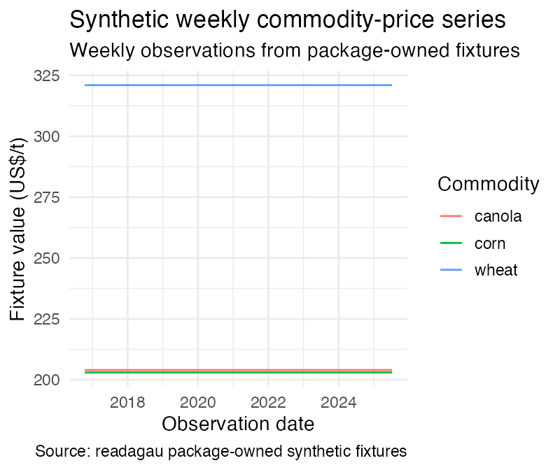

readagau
================

<!-- Keep these badges only while the matching workflows exist at these paths. -->

[](https://github.com/chartwell-macro/readagau/actions/workflows/R-CMD-check.yaml)
[](https://github.com/chartwell-macro/readagau/actions/workflows/pkgdown.yaml)

`readagau` provides reproducible access to versioned Australian
agricultural data published by the Australian Bureau of Agricultural and
Resource Economics and Sciences (ABARES).

It discovers exact releases, caches official source assets immutably,
parses workbooks and reports into semantic observations, and retains
release, table, provider, source URL, content-hash, and parser-version
provenance.

> **Development status:** `readagau` is not yet available on CRAN. The
> GitHub installation below is the supported installation while CRAN
> publication work is completed.

## Installation

Install the current GitHub version with [`pak`](https://pak.r-lib.org/).
While the repository is private, use an authenticated GitHub session:

``` r
install.packages("pak")
pak::pak("chartwell-macro/readagau")
```

The package uses `pdftotext` when parsing historical PDF reports.
Install Poppler separately if you need PDF input, then ensure
`pdftotext` is available on `PATH`. Workbook, HTML, CSV, Word, and
packaged-fixture workflows do not require Poppler.

## First success, offline

Installed, package-owned synthetic fixtures make this first parser
workflow deterministic and fully offline. They contain purpose-built
table structures; use the live or reviewed local-source paths for
official observations.

``` r
library(readagau)

crop_path <- system.file(
  "fixtures", "workbooks", "crop-national.xlsx",
  package = "readagau"
)
stopifnot(nzchar(crop_path))

crop <- read_crop_report(
  c(national = crop_path),
  assets = "national",
  view = "canonical",
  cache_dir = file.path(tempdir(), "readagau-readme-cache")
)

validation <- validate_agau_release(crop)
stopifnot(
  inherits(crop, "crop_report_data"),
  isTRUE(validation$valid)
)

data.frame(
  class = class(crop)[1L],
  observations = nrow(crop),
  tables = length(unique(crop$table_id)),
  valid = validation$valid
)

australia <- crop[
  crop$geography == "Australia" &
    crop$table_id == "crop_national_table_11",
]
knitr::kable(utils::head(
  australia[c(
    "table_id", "geography", "commodity", "concept", "period", "value", "unit"
  )],
  4
))
#>              class observations tables valid
#> 1 crop_report_data           12      4  TRUE
```

| table_id               | geography | commodity | concept    | period  | value | unit    |
|:-----------------------|:----------|:----------|:-----------|:--------|------:|:--------|
| crop_national_table_11 | Australia | Wheat     | Area       | 2024-25 | 11800 | ’000 ha |
| crop_national_table_11 | Australia | Wheat     | Production | 2024-25 | 35000 | kt      |
| crop_national_table_11 | Australia | Wheat     | Area       | 2025-26 | 12000 | ’000 ha |
| crop_national_table_11 | Australia | Wheat     | Production | 2025-26 | 35985 | kt      |

<!-- GENERATED OUTPUT: regenerate README.md by knitting README.Rmd after any
     fixture or parser change. Do not hand-write counts or values here. -->

The result is a tibble with the product-specific `crop_report_data`
class and the shared `agau_data` class. `validate_agau_release()`
returns an `agau_validation_report`; its `valid` field records whether
the parsed release satisfies the observation contract.

## Retrieve and chart a time series

Select supported releases and series, retrieve their observations, and
retain the returned date, value, and series columns for plotting.
Installed package-owned fixtures keep this example deterministic and
offline; their values are synthetic parser inputs, not official prices.
For official data, use an exact release ID or `"latest"` after reviewing
its attribution and rights fields.

``` r
weekly_catalogue <- list_agau_releases(
  products = "weekly_commodity_prices",
  refresh = FALSE
)

selected_dates <- as.Date(c("2016-10-13", "2021-03-25", "2025-07-10"))
selected <- weekly_catalogue[
  weekly_catalogue$release_date %in% selected_dates &
    weekly_catalogue$support_status == "supported",
  c("release_id", "release_date")
]
selected <- selected[order(selected$release_date), ]

weekly_series <- agau_series_catalog("weekly_commodity_prices")
selected_series <- weekly_series[
  weekly_series$source_series_id %in% c("A2", "A3", "A4") &
    weekly_series$admission_status == "supported",
  c("source_series_id", "commodity")
]

fixture_names <- paste0(
  "weekly-", format(selected$release_date, "%Y-%m-%d"), ".txt"
)
weekly_paths <- system.file(
  "fixtures", "text", fixture_names, package = "readagau"
)

weekly <- read_agau_prices(
  snapshot = weekly_paths,
  series = selected_series$source_series_id,
  measures = "latest_price",
  include_charts = FALSE,
  cache_dir = file.path(tempdir(), "readagau-readme-chart-cache")
)

chart_data <- weekly[
  weekly$record_role == "latest_price" &
    weekly$unit == "US$/t" &
    !is.na(weekly$value) &
    !is.na(weekly$observation_date),
  c("observation_date", "commodity", "value", "unit")
]
chart_data <- chart_data[
  order(chart_data$observation_date, chart_data$commodity),
]

if (requireNamespace("ggplot2", quietly = TRUE)) {
  price_plot <- ggplot2::ggplot(
    chart_data,
    ggplot2::aes(
      x = observation_date, y = value,
      colour = commodity, group = commodity
    )
  ) +
    ggplot2::geom_line() +
    ggplot2::labs(
      title = "Synthetic weekly commodity-price series",
      subtitle = "Weekly observations from package-owned fixtures",
      x = "Observation date",
      y = "Fixture value (US$/t)",
      colour = "Commodity",
      caption = "Source: readagau package-owned synthetic fixtures"
    ) +
    ggplot2::theme_minimal(base_size = 13)
  price_plot
}
```

<!-- The hidden asset chunk refreshes the checked-in figure when ggplot2 is
     available. Keeping the PNG under man/figures makes the rendered README
     and pkgdown home page deterministic in lean documentation environments. -->



The same returned fields are available when parsing an exact report or a
current online snapshot. Keep `source_asset`, `sha256`,
`parser_version`, and the rights/provenance columns with any derived
series so a chart remains tied to the source snapshot that produced it.
The [Getting Started
article](https://chartwell-macro.github.io/readagau/articles/getting-started.html)
extends this workflow to nine dated fixtures and shows the retained
provenance.

## Find an exact release

Use `list_agau_releases()` to inspect the checked-in release catalogue
and support status. The default call uses bundled or cached metadata and
does not refresh official pages.

``` r
releases <- list_agau_releases(
  products = "crop_report",
  refresh = FALSE
)

preview <- releases[seq_len(min(6L, nrow(releases))), c(
  "product", "release_id", "release_date",
  "support_status", "unsupported_reason"
)]
knitr::kable(preview)
```

| product | release_id | release_date | support_status | unsupported_reason |
|:---|:---|:---|:---|:---|
| crop_report | acr-2010-02-01-no-153 | 2010-02-01 | supported | NA |
| crop_report | acr-2010-06-01-no-154 | 2010-06-01 | supported | NA |
| crop_report | acr-2010-09-01-no-155 | 2010-09-01 | supported | NA |
| crop_report | acr-2010-12-01-no-156 | 2010-12-01 | supported | NA |
| crop_report | acr-2011-02-01-no-157 | 2011-02-01 | supported | NA |
| crop_report | acr-2011-06-01-no-158 | 2011-06-01 | supported | NA |

Use an exact `release_id` marked `supported` for parser-backed,
reproducible retrieval. The catalogue also records discovered-unverified
releases for audit and review. The value `"latest"` is convenient for
exploration; persist the selected release ID for a published analysis.

## Supported sources

| Source | Reader | Typical inputs | Main controls |
|----|----|----|----|
| Australian Crop Report | `read_crop_report()` | National/state workbooks or local files | `assets`, `tables`, `geography`, `crops`, `measures`, `view` |
| Agricultural Commodities outlook and statistics | `read_agricultural_commodities()` | Outlook/statistics workbooks or local files | `datasets`, `tables`, `sectors`, `commodities`, `concepts`, `view` |
| Australian Farm Productivity | `read_farm_productivity()` | Supporting workbook or local file | `adjustment`, `industries`, `geography`, `view` |
| Weekly commodity prices | `read_agau_prices()` | Current pages, exact reports, HTML/PDF/Word/text/ZIP files | `snapshot`, `series`, `measures`, `include_charts`, date limits |
| Historical Agricultural Forecast Database | `read_agau_forecast_history()` | Local CSV/workbook or official landing page | `path`, `refresh`, `cache_dir` |

The checked-in catalogues determine exact table families, release
identities, and support status. Use `agau_source_catalog()` for source
families and `agau_series_catalog()` for stable semantic series.

## Common workflows

### Read an exact official edition

This live workflow is shown explicitly; the README renders from the
offline examples above.

``` r
crop <- read_crop_report(
  release = "acr-2026-06-02-no-218",
  assets = "national",
  view = "canonical"
)
```

The first call may download and cache the exact official asset. Persist
the release ID, package version, source hash, and parser version with
derived results.

### Read a local file

``` r
reported <- read_crop_report(
  c(national = crop_path),
  assets = "national",
  view = "reported",
  cache_dir = file.path(tempdir(), "readagau-readme-local-cache")
)
stopifnot(inherits(reported, "crop_report_data"))
```

A local file receives a checksum-qualified local identity. Assign
reviewed official identity by supplying both `release_id` and
`release_date`; filenames and modification times remain local file
metadata.

### Choose reported or canonical observations

``` r
reported <- read_crop_report(
  c(national = crop_path), assets = "national", view = "reported"
)
canonical <- read_crop_report(
  c(national = crop_path), assets = "national", view = "canonical"
)
```

`reported` preserves every admitted source row. `canonical` applies the
versioned precedence policy and returns one stable observation where
source identities are proven equivalent. Equal-priority conflicting
values raise a typed validation error for explicit review.

### Cache an exact release

This live cache workflow is shown explicitly; the README renders from
local fixtures.

``` r
assets <- download_agau_release(
  product = "crop_report",
  release = "acr-2026-06-02-no-218",
  assets = "national"
)

assets[c(
  "product", "release_id", "asset_type",
  "source_url", "sha256", "local_path"
)]
```

Raw assets are stored under a content-addressed path of the form:

``` text
raw/<product>/<release_id>/<sha256>/<asset>
```

Refreshing discovery or downloading changed source bytes appends a new
hash and preserves the existing raw snapshot.

### Read local weekly prices

``` r
weekly_path <- system.file(
  "fixtures", "html", "weekly-prices-current.html",
  package = "readagau"
)

weekly <- read_agau_prices(
  snapshot = weekly_path,
  include_charts = FALSE
)

knitr::kable(utils::head(
  weekly[c("release_date", "table_id", "concept", "period", "value", "unit")],
  6
))
```

| release_date | table_id | concept | period | value | unit |
|:---|:---|:---|:---|---:|:---|
| 2026-07-23 | weekly_A1 | annual price change | 2026-07-22 | 5 | percent |
| 2026-07-23 | weekly_A1 | price | 2026-07-22 | 101 | exchange_rate_ratio |
| 2026-07-23 | weekly_A1 | previous-week price | 2026-07-22 | 191 | exchange_rate_ratio |
| 2026-07-23 | weekly_A1 | price 12 months ago | 2026-07-22 | 151 | exchange_rate_ratio |
| 2026-07-23 | weekly_A1 | weekly price change | 2026-07-22 | 1 | percent |
| 2026-07-23 | weekly_A10 | annual price change | 2026-07-22 | 5 | percent |

For current online data, use `snapshot = "latest"`. For an exact dated
report, use an ISO date or a release ID. For the complete supported
table history, use `snapshot = "all"` with optional `from` and `to`
limits.

### Read the Historical Agricultural Forecast Database

``` r
forecast_path <- system.file(
  "fixtures", "workbooks", "historical-forecast.csv",
  package = "readagau"
)

forecast_history <- read_agau_forecast_history(path = forecast_path)

knitr::kable(utils::head(
  forecast_history[c(
    "commodity", "estimate_type", "region", "year_issued",
    "forecast_year_fy", "original_forecast", "latest_actual"
  )],
  6
))
```

| commodity | estimate_type | region | year_issued | forecast_year_fy | original_forecast | latest_actual |
|:---|:---|:---|---:|:---|---:|---:|
| Wheat | Production | Australia | 2025 | 2025-26 | 30560 | 35985 |
| Wheat | Production | Australia | 2026 | 2025-26 | 35985 | 35985 |

This reader has a distinct `agau_forecast_history` output contract
rather than the shared observation schema used by the workbook and
weekly-price readers.

### Compare vintages

Vintage comparisons require exact releases. They support `crop_report`,
`agricultural_commodities`, and `farm_productivity`.

This live comparison workflow is shown explicitly; the README renders
from offline data.

``` r
forecast_revisions <- compare_agau_vintages(
  product = "agricultural_commodities",
  releases = c("ac-2026-03-03", "ac-2026-06-02"),
  comparison = "forecast_revision"
)
```

The specialised operations are also available directly:

``` r
agau_history_revision(data)
agau_forecast_revision(data)
agau_forecast_error(data, realisation = "first")
agau_forecast_error(data, realisation = "latest_revised")
```

Comparisons join semantic observation keys rather than row positions.
Forecast errors distinguish the first later realisation from the latest
revised value.

## Output contract

The main product readers return tibbles with these product-specific
classes:

- `crop_report_data`
- `agricultural_commodities_data`
- `farm_productivity_data`
- `agau_weekly_prices`

Each also inherits from `agau_data`.

The shared observation fields include source identity, semantic
identity, period semantics, values, missing-value reasons, and
provenance. In particular, the contract retains `series_id`,
`observation_key`, `raw_value`, `missing_reason`, `source_note`,
`sha256`, `parser_version`, and source rights metadata alongside the
parsed numeric `value`.

Missing, suppressed, confidential, unavailable, bounded, and
provider-error cells remain numeric `NA` with an explicit reason where
the source supports one. They are never converted to zero.

Inspect the contracts directly:

``` r
agau_observation_schema()
agau_release_manifest_schema()
agau_raw_asset_manifest_schema()
```

## Network, cache, and offline behavior

`agau_cache_dir()` returns the platform-appropriate cache location:

``` r
agau_cache_dir()
```

The default is managed through `tools::R_user_dir("readagau", "cache")`.
Downloaded assets stay within that managed cache (or an explicitly
supplied `cache_dir`), leaving the project directory and direct home
paths untouched.

Network access can occur when:

- `list_agau_releases(refresh = TRUE)` refreshes official landing pages;
- a reader resolves `"latest"` without a complete cache hit;
- `download_agau_release()` retrieves a missing exact asset;
- `read_agau_prices(snapshot = "latest")` retrieves current pages; or
- `read_agau_forecast_history(path = NULL)` discovers the official
  database.

Local files and valid exact cache hits can be replayed offline. Use a
dedicated temporary `cache_dir` in isolated examples and tests.

Network requests have a 60-second per-request timeout and a bounded
three-try, 180-second retry window. Transport failures use typed package
conditions and do not silently return partial observations.

No credentials are required for the package’s public official sources.
Source availability, upstream URL changes, and third-party source terms
remain outside the package’s control.

## Scope and limitations

- Use a release marked `supported` for reproducible product reads. A
  release marked `discovered-unverified` remains visible for audit and
  may be unavailable to a product reader until its source profile is
  reviewed.
- Use an exact release ID for published analyses; `"latest"` is a
  convenient exploration selector whose source can change over time.
- Schema gates validate the admitted structure of official workbooks and
  pages, and fail closed when an upstream asset changes shape or
  disappears.
- Install Poppler’s `pdftotext` when PDF input is part of a workflow.
  HTML, text, Word, CSV, workbook, and packaged-fixture paths work
  without Poppler.
- `read_agau_prices()` has a dedicated weekly-price contract. Use the
  vintage comparison helpers for the supported workbook products, and
  use the weekly reader for weekly price history.
- Package code and package-owned synthetic fixtures: MIT, copyright
  Chartwell Macro. ABARES and third-party source-data terms, trademarks, logos,
  the Commonwealth Coat of Arms, and other excluded material continue to
  govern upstream content.
- Preserve the returned provenance and attribution fields when
  publishing or redistributing derived values; a successful parse alone
  does not change the source’s rights or terms.

## Troubleshooting

| Symptom | Likely cause | What to inspect |
|----|----|----|
| Release discovery fails | Official landing page or network problem | Retry with `refresh = FALSE`; inspect the cached/bundled catalogue |
| Requested asset is absent | Release or asset role is unsupported | Check `list_agau_releases()` and `asset_roles` |
| Download fails | Transport, permissions, or cache-lock problem | Check connectivity, `cache_dir`, and the exact release ID |
| File extension looks wrong | ABARES published a misleading extension | Use `agau_detect_format(path)`; detection uses file bytes |
| Workbook is rejected | New sheet/layout/payload structure | Record product, release, sheet/table, SHA-256, parser version, and condition class |
| Canonicalisation reports a collision | Distinct source dimensions were not equivalent | Re-read with `view = "reported"` and inspect geography, sector, method, unit, and period metadata |
| PDF parsing fails | `pdftotext` is unavailable or unsuitable | Install Poppler or use an official HTML, Word, workbook, or text source |
| Cached replay reaches the network | Discovery or requested assets are incomplete | Retain both the discovery manifest and content-addressed raw tree |

Typed conditions include `agau_release_discovery_error`,
`agau_asset_missing_error`, `agau_download_error`,
`agau_dependency_error`, `agau_asset_format_error`, `agau_schema_error`,
`agau_table_parse_error`, `agau_endpoint_error`, and
`agau_validation_error`. Warning classes include status, duplicate, and
cadence warnings; inspect them rather than globally suppressing them.

When reporting a problem, include:

``` r
sessionInfo()
packageVersion("readagau")
```

Also include the exact product, release ID or local path type, selected
assets or datasets, view, parser version, condition class, and a minimal
synthetic reproduction. Keep official workbooks, restricted source
files, and cache contents out of issue attachments.

## Citation and licensing

Cite the package in R with:

``` r
citation("readagau")
```

Primary author and maintainer: **Chartwell Macro**. The same name is recorded as
the package copyright holder in `LICENSE`.

For source attribution guidance:

``` r
agau_attribution()
crop_report_attribution()
```

Package code and package-owned synthetic fixtures: MIT, copyright Chartwell
F. Source data remain subject to ABARES and any upstream provider terms,
exclusions, and attribution requirements.

## Contributing

Bug reports, documentation improvements, and reproducible parser-support
requests are welcome by email to [chartwellmacro@gmail.com](mailto:chartwellmacro@gmail.com).

Before emailing a report, include the smallest reproducible example
possible and the relevant release identity, source hash, parser version,
and condition class. Use package-owned synthetic inputs when a file is
needed so official workbooks and restricted values stay with their
governed source.

See [`CONTRIBUTING.md`](CONTRIBUTING.md) for development and fixture
policy, and the [pkgdown
changelog](https://chartwell-macro.github.io/readagau/news/index.html) for
package changes.

## Further reading

- [Getting
  started](https://chartwell-macro.github.io/readagau/articles/getting-started.html)
- [Source files and
  vintages](https://chartwell-macro.github.io/readagau/articles/source-files-and-vintages.html)
- [Crop Report
  tables](https://chartwell-macro.github.io/readagau/articles/crop-report-tables.html)
- [Agricultural Commodities and ACS
  tables](https://chartwell-macro.github.io/readagau/articles/agricultural-commodities-and-acs.html)
- [Farm productivity
  methods](https://chartwell-macro.github.io/readagau/articles/farm-productivity-methods.html)
- [Weekly commodity
  prices](https://chartwell-macro.github.io/readagau/articles/weekly-commodity-prices.html)
- [Historical Agricultural Forecast
  Database](https://chartwell-macro.github.io/readagau/articles/historical-forecast-database.html)
- [Comparing revisions and
  errors](https://chartwell-macro.github.io/readagau/articles/comparing-revisions-and-errors.html)
- [Cache, offline use, and
  troubleshooting](https://chartwell-macro.github.io/readagau/articles/cache-and-troubleshooting.html)
- [Reference
  documentation](https://chartwell-macro.github.io/readagau/reference/index.html)
